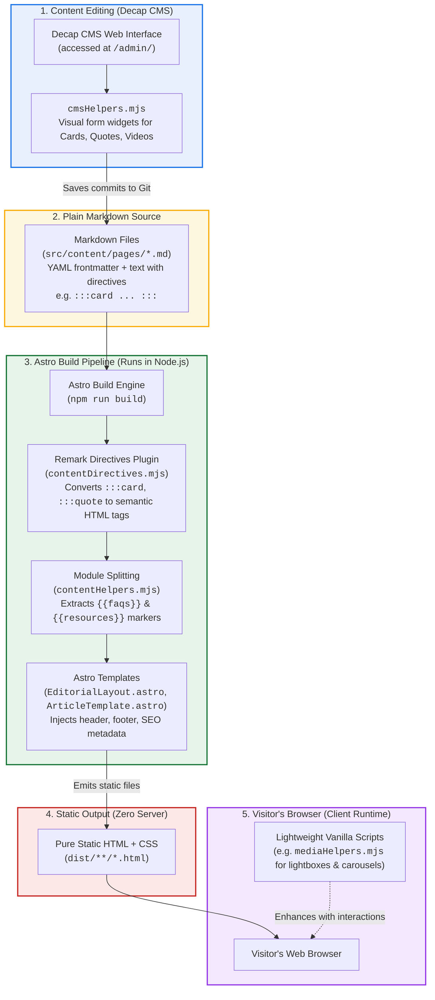
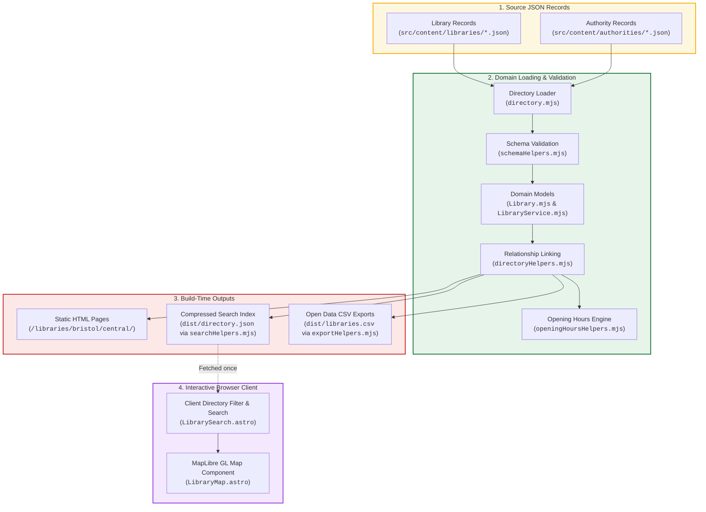

# Content & Data Pipeline Architecture

An idiot-proof, diagrammed guide to how LibraryCommons turns content and data into a lightning-fast static website.

---

## 1. The 30-Second Summary

LibraryCommons is a **100% static website** generated by [Astro](https://astro.build). There is **no database** and **no backend server** running in production.

All content and data live directly in the Git repository as plain files:
1. **Editorial Articles & Pages**: Stored as Markdown files (`src/content/pages/*.md`) with frontmatter metadata.
2. **Library Directory**: Stored as structured JSON files (`src/content/libraries/*.json` and `src/content/authorities/*.json`).

When code or content changes, Astro runs a **build step** that converts those files into static HTML, CSS, and pre-computed JSON files (`dist/`). The static files are then uploaded to hosting (GitHub Pages / Netlify).

---

## 2. Content Pipeline: From CMS to Browser

This diagram shows the complete lifecycle of an editorial page—from authoring to the reader's browser:



### Step-by-Step Breakdown

1. **Editing in Decap CMS (`/admin/`)**:
   - An editor logs into `/admin/` in their browser.
   - Decap CMS uses custom editor components defined in `cmsHelpers.mjs` (for Cards, Quotes, Videos, and Hotspots) so editors don't have to write raw code.
   - When the editor clicks **Publish**, Decap commits a change directly to the Git repository.

2. **Source Markdown Files (`src/content/pages/*.md`)**:
   - The file contains metadata at the top (title, dates, lead image, tags) followed by markdown text.
   - Special blocks use standard markdown container directives, for example:
     ```markdown
     :::card{title="Bristol Central Library" image="/media/bristol.jpg"}
     Historic central library in Bristol.
     :::
     ```

3. **Build Pipeline (`astro build`)**:
   - **`contentDirectives.mjs`**: An Astro/Remark plugin that intercepts the `:::card` directive before it becomes HTML, converting it into accessible, styled `<div class="content-card">` HTML markup.
   - **`markdownHelpers.mjs`**: Normalizes list spacing, ensures image paths resolve correctly, and obfuscates contact emails to deter spam scrapers.
   - **`contentHelpers.mjs`**: Uses Cheerio (a server-side HTML parser) to scan the HTML for special markers like `{{faqs}}` and `{{resources}}`, splitting the content so Astro can insert dedicated FAQ accordions and resource cards at those exact locations.
   - **Templates**: Selected templates (`ArticleTemplate.astro`, `HomeTemplate.astro`, etc.) wrap the content in the site header, navigation, and footer.

4. **Static Output (`dist/`)**:
   - Astro writes plain `.html` files to disk. There is no Node.js server or database needed to view them.

5. **Client Runtime (Visitor's Browser)**:
   - The visitor requests a page. The static HTML loads instantly.
   - If the page has an image gallery or carousel, `mediaHelpers.mjs` attaches event listeners for lightboxes and carousel scrolling.

---

## 3. Directory Data Pipeline: From JSON to Map & Search

The directory follows a parallel static data pipeline:



---

## 4. `src/lib/` Code Inventory by Domain Directory

The codebase is organized into domain-specific subdirectories under `src/lib/` (with pure browser scripts in `src/scripts/` and backwards-compatible re-exports in `src/lib/helpers/`):

| Category | File | Where It Runs | What It Does (Plain English) |
|---|---|---|---|
| **CMS Admin (`src/lib/cms/`)** | `cms/cmsHelpers.mjs` | Browser (`/admin/` only) | Visual editing widgets and markdown serializers for Decap CMS. |
| **CMS Admin (`src/lib/cms/`)** | `cms/reviewHelpers.mjs` | Browser (`/admin/review/`) | Data validation inspector and audit reviewer for directory records. |
| **Content Pipeline (`src/lib/content/`)** | `content/contentDirectives.mjs` | Node.js (Build time) | Remark plugin that turns `:::card` and `:::quote` into semantic HTML. |
| **Content Pipeline (`src/lib/content/`)** | `content/markdownHelpers.mjs` | Node.js (Build time) | Fixes markdown list indentation, cleans image URLs, and obfuscates emails. |
| **Content Pipeline (`src/lib/content/`)** | `content/contentHelpers.mjs` | Node.js (Build time) | Splits HTML to inject FAQ and Resource blocks; chooses templates. |
| **Content Pipeline (`src/lib/content/`)** | `content/newsHelpers.mjs` | Node.js (Build time) | Loads, filters, and groups news stories by stakeholder, council, or date. |
| **Content Pipeline (`src/lib/content/`)** | `content/resourceHelpers.mjs` | Node.js (Build time) | Loads and filters downloadable documents and web resources. |
| **Directory Domain (`src/lib/directory/`)** | `directory/directoryLoader.mjs` | Node.js (Build time) | High-level dataset loader that reads all JSON records from disk (re-exported via `src/lib/directory.mjs`). |
| **Directory Domain (`src/lib/directory/`)** | `directory/models/Library.mjs` | Node.js (Build time) | Class representing a library building (name, address, hours, services). |
| **Directory Domain (`src/lib/directory/`)** | `directory/models/LibraryService.mjs` | Node.js (Build time) | Class representing a council service (service URL, member branches). |
| **Directory Domain (`src/lib/directory/`)** | `directory/directoryHelpers.mjs` | Node.js (Build time) | Links libraries to councils, finds nearby libraries, builds breadcrumbs. |
| **Directory Domain (`src/lib/directory/`)** | `directory/openingHoursHelpers.mjs` | Node.js & Browser | Calculates if a library is open right now in UK local time (BST/GMT). |
| **Directory Domain (`src/lib/directory/`)** | `directory/dataHelpers.mjs` | Node.js (Build time) | Formats UK postcodes, addresses, and accessibility labels. |
| **Directory Domain (`src/lib/directory/`)** | `directory/geoHelpers.mjs` | Node.js & Browser | Calculates distances in miles (Haversine formula) and map URLs. |
| **Directory Domain (`src/lib/directory/`)** | `directory/schemaHelpers.mjs` | Node.js (Build / CLI) | Validates directory records against Table Schema specifications. |
| **Directory Domain (`src/lib/directory/`)** | `directory/exportHelpers.mjs` | Node.js (Build time) | Serializes validated directory data into public CSV download files. |
| **Directory Domain (`src/lib/directory/`)** | `directory/searchHelpers.mjs` | Node.js & Browser | Compresses directory data for `/directory.json`; filters search results. |
| **Site & SEO (`src/lib/site/`)** | `site/siteHelpers.mjs` | Node.js (Build time) | Site URL resolving, path canonicalization, and date formatting. |
| **Site & SEO (`src/lib/site/`)** | `site/seoHelpers.mjs` | Node.js (Build time) | Generates Schema.org JSON-LD structured data for Google search indexing. |
| **Site & SEO (`src/lib/site/`)** | `site/sitemapHelpers.mjs` | Node.js (Build time) | Builds the hierarchical navigation sitemap tree. |
| **Browser Runtime (`src/scripts/`)** | `src/scripts/mediaClient.mjs` | Visitor's Browser DOM | Interactive lightbox modals, image zoom, collection carousels, and accordions. |
| **Browser Runtime (`src/scripts/`)** | `src/scripts/shareClient.mjs` | Visitor's Browser DOM | Native Web Share API dialog with fallback. |
| **Compatibility Bridge (`src/lib/helpers/`)** | `helpers/*.mjs` | Re-export layer | Transparent re-exports pointing to the domain directories so legacy imports never break. |

---

## 5. Architectural Standards & Organization

### Structure Summary

1. **`src/lib/cms/` — CMS Authoring & Administration**:
   - Custom Decap CMS widgets (Cards, Quotes, Videos, Hotspots).
   - Review and audit worklist viewers for `/admin/review/`.
2. **`src/lib/content/` — Editorial Content Build Pipeline**:
   - Remark plugins and container directives.
   - Markdown list normalization, image resolution, and protected email decoding.
   - Editorial HTML splitting (`{{faqs}}`, `{{resources}}`) and template matching.
   - News and resource loaders.
3. **`src/lib/directory/` — Directory Domain & Data Pipeline**:
   - Domain models: `models/Library.mjs` and `models/LibraryService.mjs`.
   - Core loader: `directoryLoader.mjs` (read directly at build time).
   - Domain logic: `openingHoursHelpers.mjs`, `geoHelpers.mjs`, `dataHelpers.mjs`, `directoryHelpers.mjs`.
   - Validation & Export: `schemaHelpers.mjs`, `exportHelpers.mjs`, `searchHelpers.mjs`.
4. **`src/lib/site/` — Site Infrastructure & SEO**:
   - Canonical URLs, base paths, and British date formatting (`siteHelpers.mjs`).
   - Schema.org JSON-LD generators and XML sitemap (`seoHelpers.mjs`).
   - Hierarchical page navigation tree (`sitemapHelpers.mjs`).
5. **`src/scripts/` — Client-Side Browser DOM Scripts**:
   - Browser-only scripts that interact with `document` or `window` (`mediaClient.mjs`, `shareClient.mjs`).
   - Packaged and optimized directly by Vite for runtime delivery.
6. **`src/lib/helpers/` — Compatibility Bridge**:
   - Barrel files re-exporting every function from its new domain home, ensuring zero breakage for external scripts or existing tests.
