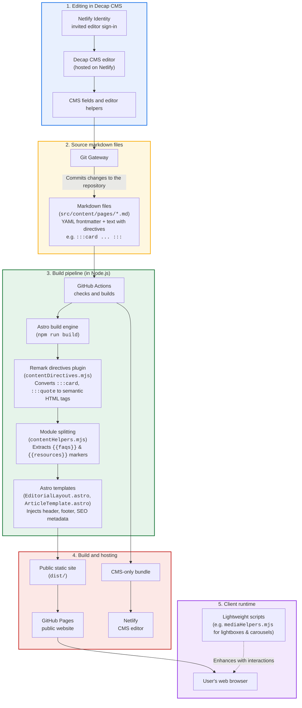
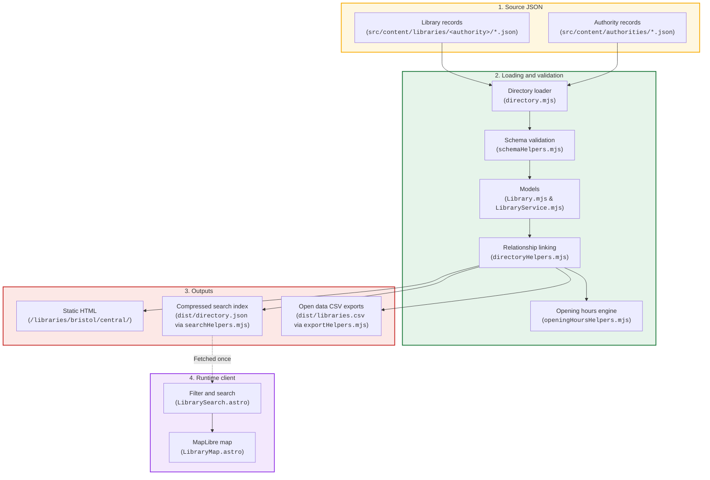

# Content and data pipeline

This guide shows how LibraryCommons turns content and data into a static website.

## 1. Summary

The public LibraryCommons website is a **static site** generated by [Astro](https://astro.build). It needs no database or application server to serve public pages. The Decap CMS editor is hosted separately on Netlify; Netlify Identity and Git Gateway let invited editors sign in and save changes to this repository.

All content and data live directly in the Git repository as plain files:

1. **Articles and pages**: Stored as Markdown files in `src/content/`, including `src/content/pages/`, with frontmatter metadata.
2. **Library directory**: Stored as structured JSON files (`src/content/libraries/<authority>/*.json` and `src/content/authorities/*.json`).
3. **Site settings and lookup data**: Stored in `src/data/`.

When changes reach `main`, GitHub Actions runs the checks and builds the public site. The static files in `dist/` are published to GitHub Pages. A separate CMS-only bundle is deployed to Netlify; Netlify does not host the public site. Some optional directory features, such as maps and place-name lookup, load public data or map tiles from external services.

## 2. Content pipeline: CMS to browser

This diagram shows the complete lifecycle of an editorial page—from authoring to the reader's browser:



### Step by step

1. **Editing in Decap CMS (`/admin/`)**:
   - An invited editor signs in to the Netlify-hosted CMS using Netlify Identity.
   - Decap CMS presents forms for editing pages, FAQs, library records, and other content. Some fields use project-specific controls.
   - When the editor clicks **Publish**, Git Gateway commits the change to the repository.

2. **Source markdown files (`src/content/pages/*.md`)**:
   - The file contains metadata at the top (title, dates, lead image, tags) followed by markdown text.
   - Special blocks use standard markdown container directives, for example:

     ```markdown
     :::card{title="Bristol Central Library" image="/media/bristol.jpg"}
     Historic central library in Bristol
     :::
     ```

3. **Build pipeline (`astro build`)**:
   - GitHub Actions runs the automated checks, then Astro processes the source files to produce the public site.
   - **`contentDirectives.mjs`**: An Astro/Remark plugin that converts explicit Markdown blocks such as `:::card` and `:::quote` into accessible, styled page content.
   - **`markdownHelpers.mjs`**: Normalizes list spacing, ensures image paths resolve correctly, and obfuscates contact emails to deter spam scrapers.
   - **`contentHelpers.mjs`**: Uses Cheerio (an HTML parser) to scan the HTML for special markers like `{{faqs}}` and `{{resources}}`, splitting the content so Astro can insert dedicated FAQ accordions and resource cards at those exact locations.
   - **Templates**: Selected templates (`ArticleTemplate.astro`, `HomeTemplate.astro`, etc.) wrap the content in the site header, navigation, and footer.

4. **Build output and hosting**:
   - Astro writes the public HTML, styles, and generated data files to `dist/`; GitHub Actions publishes these files to GitHub Pages.
   - GitHub Actions separately packages the CMS editor for Netlify. The public site and CMS are hosted separately.

5. **Client runtime**:
   - The visitor requests a page. The static HTML loads instantly.
   - Browser scripts add interactions such as image galleries, carousels, directory filters, maps, and place lookup where those features are used.

## 3. Library directory pipeline: JSON to map

The directory follows a parallel static data pipeline:



## 4. `src/lib/` Code inventory

The codebase is organized into domain-specific subdirectories under `src/lib/`:

| Category                                    | File                                  | Where It Runs              | What It Does (Plain English)                                                                               |
| ------------------------------------------- | ------------------------------------- | -------------------------- | ---------------------------------------------------------------------------------------------------------- |
| **CMS Admin (`src/lib/cms/`)**              | `cms/cmsHelpers.mjs`                  | Browser (`/admin/` only)   | Visual editing widgets and markdown serializers for Decap CMS.                                             |
| **CMS Admin (`src/lib/cms/`)**              | `cms/reviewHelpers.mjs`               | Browser (`/admin/review/`) | Data validation inspector and audit reviewer for directory records.                                        |
| **Content Pipeline (`src/lib/content/`)**   | `content/activityHelpers.mjs`         | Node.js (Build time)       | Loads authority library usage data and builds advocacy impact summaries.                                   |
| **Content Pipeline (`src/lib/content/`)**   | `content/contentDirectives.mjs`       | Node.js (Build time)       | Remark plugin that turns `:::card` and `:::quote` into semantic HTML.                                      |
| **Content Pipeline (`src/lib/content/`)**   | `content/markdownHelpers.mjs`         | Node.js (Build time)       | Fixes markdown list indentation, cleans image URLs, and obfuscates emails.                                 |
| **Content Pipeline (`src/lib/content/`)**   | `content/contentHelpers.mjs`          | Node.js (Build time)       | Splits HTML to inject FAQ and Resource blocks; chooses templates.                                          |
| **Content Pipeline (`src/lib/content/`)**   | `content/newsFormatHelpers.mjs`       | Node.js & Browser          | Formats news dates, period summaries, and story card HTML without DOM access.                              |
| **Content Pipeline (`src/lib/content/`)**   | `content/newsHelpers.mjs`             | Node.js (Build time)       | Loads, filters, and groups news stories by stakeholder, council, or date.                                  |
| **Content Pipeline (`src/lib/content/`)**   | `content/resourceHelpers.mjs`         | Node.js (Build time)       | Loads and filters downloadable documents and web resources.                                                |
| **Directory Domain (`src/lib/directory/`)** | `directory/directoryLoader.mjs`       | Node.js (Build time)       | High-level dataset loader that reads all JSON records from disk (re-exported via `src/lib/directory.mjs`). |
| **Directory Domain (`src/lib/directory/`)** | `directory/models/Library.mjs`        | Node.js (Build time)       | Class representing a library building (name, address, hours, services).                                    |
| **Directory Domain (`src/lib/directory/`)** | `directory/models/LibraryService.mjs` | Node.js (Build time)       | Class representing a council service (service URL, member branches).                                       |
| **Directory Domain (`src/lib/directory/`)** | `directory/directoryHelpers.mjs`      | Node.js (Build time)       | Links libraries to councils, finds nearby libraries, builds breadcrumbs.                                   |
| **Directory Domain (`src/lib/directory/`)** | `directory/openingHoursHelpers.mjs`   | Node.js & Browser          | Calculates if a library is open right now in UK local time (BST/GMT).                                      |
| **Directory Domain (`src/lib/directory/`)** | `directory/dataHelpers.mjs`           | Node.js (Build time)       | Formats UK postcodes, addresses, and accessibility labels.                                                 |
| **Directory Domain (`src/lib/directory/`)** | `directory/geoHelpers.mjs`            | Node.js & Browser          | Calculates distances in miles (Haversine formula) and map URLs.                                            |
| **Directory Domain (`src/lib/directory/`)** | `directory/schemaHelpers.mjs`         | Node.js (Build / CLI)      | Validates directory records against Table Schema specifications.                                           |
| **Directory Domain (`src/lib/directory/`)** | `directory/exportHelpers.mjs`         | Node.js (Build time)       | Serializes validated directory data into public CSV download files.                                        |
| **Directory Domain (`src/lib/directory/`)** | `directory/searchHelpers.mjs`         | Node.js & Browser          | Compresses directory data for `/directory.json`; filters search results.                                   |
| **Site & SEO (`src/lib/site/`)**            | `site/siteHelpers.mjs`                | Node.js (Build time)       | Site URL resolving, path canonicalization, and date formatting.                                            |
| **Site & SEO (`src/lib/site/`)**            | `site/seoHelpers.mjs`                 | Node.js (Build time)       | Generates Schema.org JSON-LD structured data for Google search indexing.                                   |
| **Site & SEO (`src/lib/site/`)**            | `site/sitemapHelpers.mjs`             | Node.js (Build time)       | Builds the hierarchical navigation sitemap tree.                                                           |
| **Browser Runtime (`src/scripts/`)**        | `src/scripts/mediaClient.mjs`         | Visitor's Browser DOM      | Interactive lightbox modals, image zoom, collection carousels, and accordions.                             |
| **Browser Runtime (`src/scripts/`)**        | `src/scripts/newsListClient.mjs`      | Visitor's Browser DOM      | Client-side time-period filtering, pagination, and archive fetching for news lists.                        |
| **Browser Runtime (`src/scripts/`)**        | `src/scripts/shareClient.mjs`         | Visitor's Browser DOM      | Native Web Share API dialog with fallback.                                                                 |

## 5. Architectural Standards & Organization

### Structure Summary

1. **`src/lib/cms/` — CMS Authoring and admin**:
   - Custom Decap CMS widgets (Cards, Quotes, Videos, Hotspots).
   - Review and audit worklist viewers for `/admin/review/`.
2. **`src/lib/content/` — Content build pipeline**:
   - Remark plugins and container directives.
   - Markdown list normalization, image resolution, and protected email decoding.
   - Editorial HTML splitting (`{{faqs}}`, `{{resources}}`) and template matching.
   - News and resource loaders.
3. **`src/lib/directory/` — Directory domain and data pipeline**:
   - Domain models: `models/Library.mjs` and `models/LibraryService.mjs`.
   - Core loader: `directoryLoader.mjs` (read directly at build time).
   - Domain logic: `openingHoursHelpers.mjs`, `geoHelpers.mjs`, `dataHelpers.mjs`, `directoryHelpers.mjs`.
   - Validation and export: `schemaHelpers.mjs`, `exportHelpers.mjs`, `searchHelpers.mjs`.
4. **`src/lib/site/` — Site infrastructure and SEO**:
   - Canonical URLs, base paths, and date formatting (`siteHelpers.mjs`).
   - Schema.org JSON-LD generators and XML sitemap (`seoHelpers.mjs`).
   - Hierarchical page navigation tree (`sitemapHelpers.mjs`).
5. **`src/scripts/` — Client-side browser**:
   - Browser-only scripts that interact with `document` or `window` (`mediaClient.mjs`, `shareClient.mjs`).
   - Packaged and optimized directly by Vite for runtime delivery.
